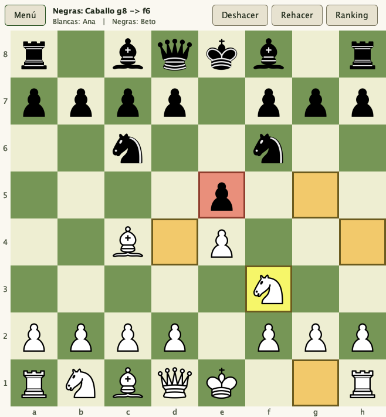

# TP Ajedrez

Ajedrez para jugar en consola o en una ventana, hecho para el TPO de Ingeniería de Software (UADE). La idea del trabajo es que las reglas del juego no dependan de cómo se muestra ni de cómo se juega, así que casi todo el código está pensado para poder cambiarse sin romper el resto.

<p align="center">
  
</p>

## Cómo correrlo

Se abre la carpeta en IntelliJ y se corre `Main` (consola), `MainSwing` (ventana) o `ChessCoreTests` (tests). Se necesita JDK 21 o superior. También por terminal con Bash (Git Bash en Windows), desde la raíz del repo:

```bash
./scripts/build.sh
java -cp out Main
java -cp out MainSwing
./scripts/test.sh
```

En la consola se elige al arrancar contra quién se juega (dos personas o la IA en tres niveles) y se mueve escribiendo `e2 e4`. Con `undo` se deshace, con `redo` se rehace y con `salir` se termina. La ventana es una sola y tiene tres pantallas. En el menú se elige 1 contra 1 o contra la IA, la dificultad (fácil, medio o difícil), el color con el que se juega (el tablero se gira si son las negras), los usuarios (el lado de la IA dice IA; si se elige "Nuevo usuario..." en un lado aparece el campo para registrarlo). En la partida se hace click en la pieza (se marcan a dónde puede ir: en ámbar los destinos libres y en rojizo las capturas) y después en el destino. Arriba hay una sola barra con Menú, lo que acaba de pasar, quién juega y los botones Deshacer, Rehacer y Ranking. El ranking también se abre en la misma ventana.

## Usuarios y ranking

Al arrancar (en consola y en ventana) cada persona puede iniciar sesión, registrarse o jugar sin usuario. No hay contraseña: se entra solo con el nombre (en la ventana se elige de una lista) y al registrarse alcanza con escribir el nombre, porque el id lo asigna el sistema solo y no hay que anotarlo. Contra la IA solo se pide el usuario del lado de la persona.

Cuando una partida termina se acredita el resultado: 3 puntos por victoria, 1 por empate, 0 por derrota. Si se deshace la jugada final, el resultado se revierte, y si se rehace vuelve a sumarse. El ranking se ordena por puntos, después por victorias y después por nombre. En la consola se ve con el comando `ranking` (y se muestra solo al terminar la partida) y en la ventana con el botón Ranking.

Los datos quedan en `data/usuarios.csv` (no se sube al repo). Para usar otra carpeta: `java -Dajedrez.data=otra_carpeta -cp out Main`. Los cambios técnicos están explicados en `docs/cambios-usuarios-y-ranking.md`.

## Verificación

`./scripts/test.sh` corre 66 pruebas del juego y la IA, 19 de usuarios y ranking, y las regresiones de consola (deshacer y repetir un mate, registro con ranking, login persistente). Para comprobar la ventana real (menú, registro, 1 contra 1, la IA en los tres niveles con blancas y con negras, deshacer, rehacer, ranking, un tablero de 10x10 y el tablero que crece con la ventana):

```bash
java --class-path out scripts/SwingIntegrationTests.java
```

## Qué reglas tiene

Todas las piezas con sus movimientos, turnos, capturas, jaque, jaque mate y ahogado, enroque, coronación (se elige la pieza), captura al paso, tablas por material insuficiente, por la regla de los 50 movimientos y por repetición, y deshacer y rehacer. El peón corona sin preguntar cuando juega la IA.

## Cómo está armado

```
src/
  core/          el núcleo: las reglas del ajedrez, sin nada de consola ni de Swing
    special/       enroque, captura al paso y coronación
    movement/      cómo se mueve cada pieza
    draw/          las condiciones de tablas
  ports/         interfaces con las que el núcleo avisa y pregunta al exterior
  adapters/      consola, Swing y archivo CSV, que implementan los puertos
  accounts/      cuentas, puntajes y ranking, con su propio puerto (IAccountStore), afuera del núcleo
  ai/            el oponente, afuera del núcleo
  Main.java      arma todo para jugar por consola
  MainSwing.java arma todo para jugar con ventana
  ChessCoreTests.java
  AccountTests.java
```

El núcleo (`core`) no conoce a los adaptadores ni a la IA: son ellos los que dependen de él. Los paquetes y los identificadores van en inglés, como pide la convención de la cátedra (comentarios en español, identificadores en inglés). Por eso la ventana y la IA se pudieron agregar sin tocar `ChessGame`.

Lo que se ve en la materia está así:

- **Núcleo y adaptadores**: lo que se llama desde afuera es `IChessGame`. Para avisar lo que pasa el núcleo usa `IMoveListener` e `IGameStatusListener`, y para preguntar a qué pieza se corona usa `IPromotionChooser`.
- **Inyección por constructor**: `ChessGame` recibe el tablero, los listeners, las reglas especiales y las reglas de tablas ya armadas. `Main`/`MainSwing` arman las partidas de juego y `SearchGames` crea la copia de búsqueda.
- **Composición sobre herencia**: hay una sola clase `Piece`, que tiene una `IMovementStrategy`. La reina combina las estrategias de la torre y el alfil.
- **Strategy**: el movimiento de cada pieza, las reglas especiales (`ISpecialMove`), las tablas (`IDrawRule`) y los niveles de la IA (`IOpponent`).
- **Factory**: `PieceFactory` es un registro de piezas, `BoardSetup` arma el tablero inicial y `Opponents` crea el oponente según el nivel.
- **Observer**: los dos listeners. `ScoreRecorder` es un observador más: acredita el resultado sin que el núcleo sepa que existen los usuarios.
- **State**: el turno y los estados terminales (mate, ahogado, tablas).
- **Command**: cada jugada es un comando que se puede deshacer y rehacer.
- **Tests sin interfaz**: `ChessCoreTests`, con un stub y un mock como dobles de prueba, y los marcados `// TDD:` escritos antes del código.

## Agregar cosas sin tocar lo que ya está

- **Una pieza nueva**: se escribe su `IMovementStrategy`, se crea un `PieceType` y se registra con `factory.register(...)`. Hay un test que lo hace con una pieza inventada que se mueve como torre y caballo.
- **Otro tamaño de tablero**: `BoardSetup.custom(10, 10, filaTrasera, piezas)` en el `GameBuilder` de `MainSwing` (o `new Board(10, 10)`). Todo pregunta a `board.isInside()` en vez de asumir 8x8, el peón corona en la última fila de ese tablero y la ventana se adapta sola: casillas cuadradas, coordenadas hasta donde haga falta y casillas más chicas si no entra en la pantalla.
- **Una regla especial o de tablas nueva**: una clase que implemente `ISpecialMove` o `IDrawRule` y una línea en `StandardRules`, que arma las reglas para la consola, la ventana y la IA.

## Cosas a tener en cuenta

La repetición de posición ignora los derechos de enroque y de captura al paso. La simulación de captura al paso no retira el peón capturado: puede permitir un jaque descubierto horizontal o rechazar una captura que eliminaría al peón que da jaque. La búsqueda de la IA usa una copia sin historial y puede evaluar de forma imprecisa el enroque, la captura al paso y las tablas. La jugada final se filtra contra las legales de la partida real.

## Documentos

En `docs/` están la justificación de las decisiones (`justificacion.md` y `.docx`), la presentación, la lista de clases para el UML y la explicación de usuarios y ranking.

Franco dibuja el UML con `docs/uml-checklist.md`. Cuando esté `docs/uml.png`, se regenera la presentación con `node scripts/build_deck.js` (hace falta `npm install pptxgenjs` una vez) para que aparezca en la diapositiva 4.

## Piezas

Las imágenes están en `src/assets/piezas/` y son el set Cburnett de Wikimedia Commons (el mismo de lichess.org), licencia CC BY-SA 3.0, autor Colin M.L. Burnett. Si falta alguna, la ventana usa un símbolo de texto.
